# 图标优先的界面（UI icon kit）

用户反馈：“UI 尽量避免纯文字，多一点 icon、图片，比如研究树这些”。本轮只改呈现层（面板渲染、CSS、新图标模块），不改规则、AI 或权威状态，也不新增玩法版本。

## 图标套件

`src/browser/ui-icons.ts` 提供共享图标：每个图标都是调色板网格（和 `src/browser/map-icons.ts` 的地图图标同一种 GBA 式硬边像素画法），首次使用时渲染成缓存的 SVG data URL，`image-rendering: pixelated` 保持锐利。新画的图标全部为本项目原创；徽章边框由代码生成（亮左上、暗右下、深色描边），图案是手工放置的填充格，自动加 1 格描边。不使用任何官方道具美术；宝可梦精灵图沿用 `public/sprites`，建筑沿用 `public/buildings/*.svg`。

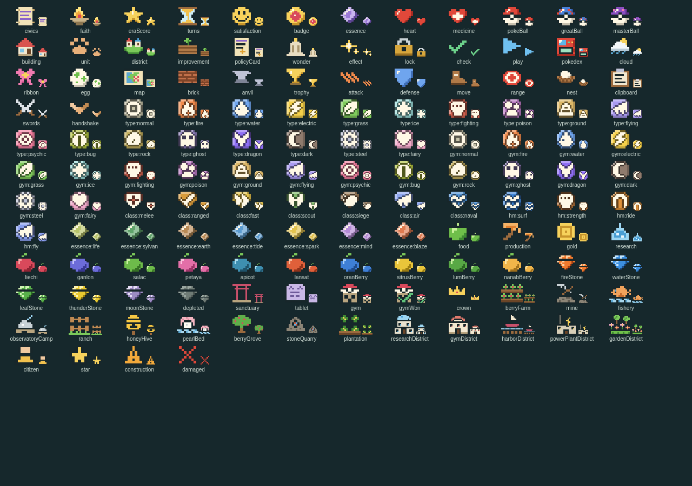

| 组 | 名称 | 说明 |
| --- | --- | --- |
| 属性徽章 `type:*` | 18 种属性 | 方形徽章，底色取自 `src/content/type-colors.ts` |
| 道馆徽章 `gym:*` | 18 种属性 | 八角形奖章，用于徽章盒 |
| 兵种 `class:*` | 近战、远程、快速、侦察、攻城、飞行、水面 | 盾形徽章 |
| 秘传 `hm:*` | 冲浪、怪力、骑乘、飞翔 | 圆形徽章 |
| 资源与计量 | `civics` 规章点、`faith` 信仰/供奉、`eraScore` 世代分、`satisfaction` 满意度、`badge` 徽章、`essence` / `essence:*` 精华（7 色）、`turns` 轮数、`heart` HP、`medicine` 恢复 | |
| 道具 | `pokeBall`、`greatBall`、`masterBall`；树果与进化石沿用地图图标（`oranBerry`、`fireStone` 等） | 原创红白配色像素画 |
| 解锁类别 | `building`、`unit`、`district`、`improvement`、`policyCard`、`wonder`、`effect` | |
| 单位属性 | `attack`、`defense`、`move`、`range`（视野用 `class:scout`） | |
| 状态与其他 | `check`、`play`、`lock`、`pokedex`、`nest`、`clipboard`、`swords`、`handshake`、`trophy`、`ribbon`、`egg`、`map`、`brick`、`anvil`、`cloud` | 科技主题图标等 |
| 地图图标复用 | 产出、资源、改良、设施区、标记 | 来自 `map-icons.ts`，经 `mapIconGrid()` 共享 |

辅助函数：`uiIcon(name, { size, label })`（有 `label` 时带 `alt` + `title`，否则 `aria-hidden`）、`artImage(src, …)`（精灵图 / 建筑 SVG）、`statChip(icon, value, label)`（图标 + 数字，`role="img"` + `aria-label`）、`typeBadge(type)`。`src/browser/ui-tip.ts` 是一张共享的悬停卡（鼠标悬停和键盘聚焦都会打开），样式与「文明 6」提示卡一致。

## 已改的面板

| 面板 | 改动 | 截图 |
| --- | --- | --- |
| 科技树 | 每个节点：主题图标、角标状态（完成 / 研究中 / 锁定）、科研与轮数图标、图鉴发现标记、解锁图标条（招募物种精灵图、建筑 SVG、设施区/改良图标、秘传徽章、效果图标）。完整文字移到悬停卡和右侧详情；前置连线、键盘与滚动不变。旧版三层研究页也换成图标解锁行。 | 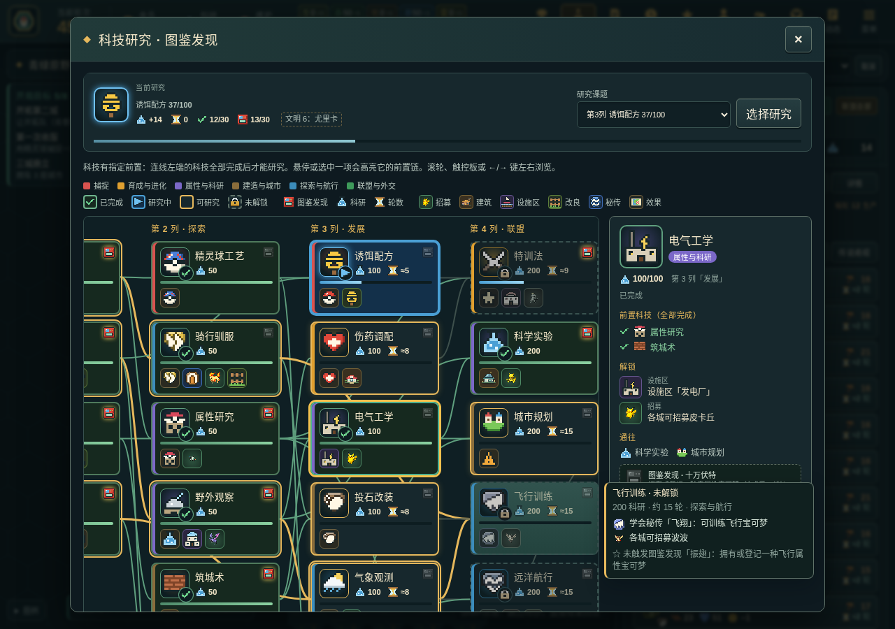 |
| 规章树与体制 | 规章徽记 + 状态角标、规章点/轮数图标、槽位小卡、方针卡图标（名称与效果是可访问名称）；体制卡显示徽记、层级、领袖偏好星标和效果图标。 | 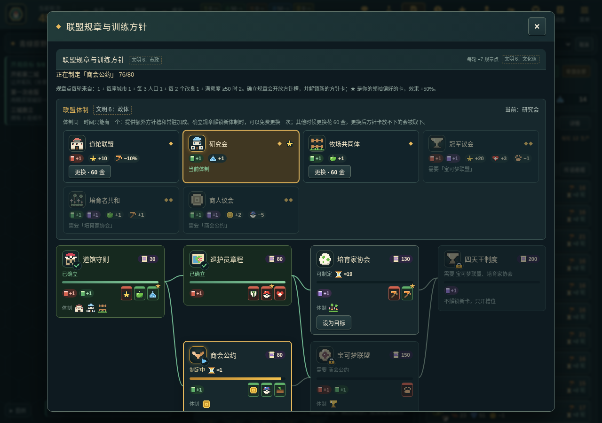 |
| 城市生产 | 精灵图/建筑图带兵种盾徽；建筑产出、攻防、维护改为图标数字；生产与轮数图标；产出格与设施区用图标。 | 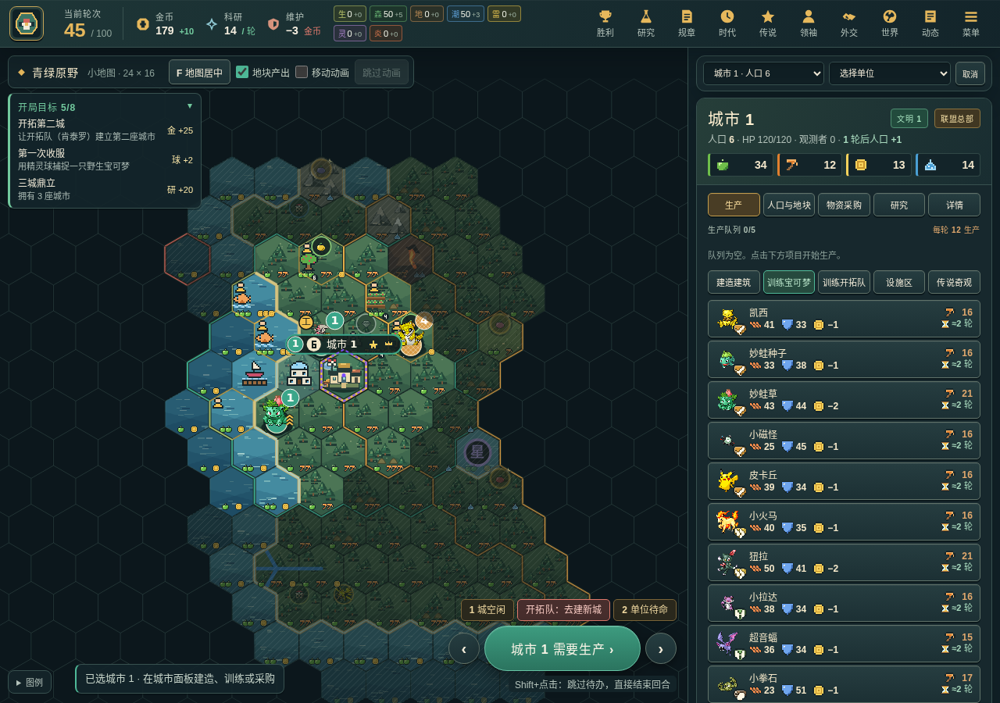 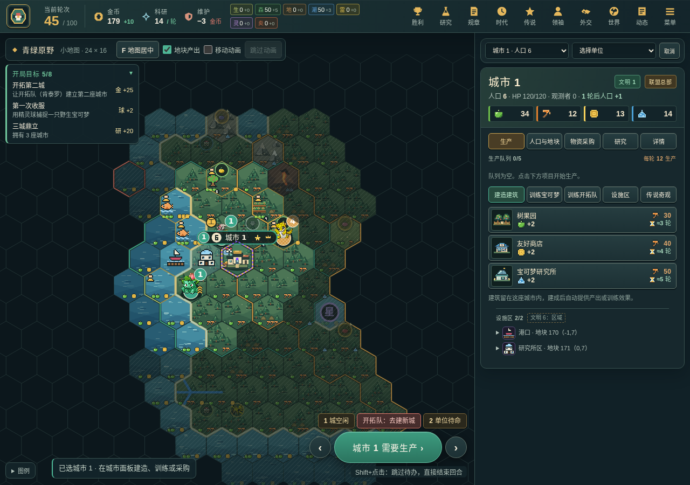 |
| 时代与献礼 | 世代分图标、每种得分里程碑图标、黑暗/黄金线图标、时代能力图标与解锁角标、献礼「承诺/黄金」图标。 | 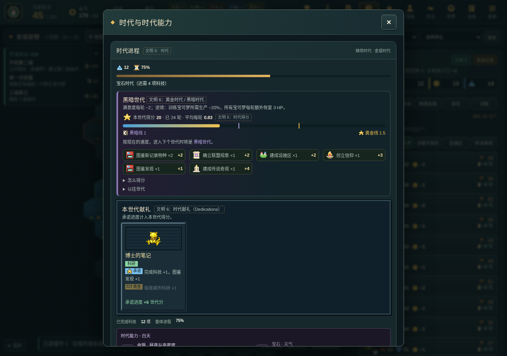 |
| 世界页 | 图鉴计数图标 + 已观察物种精灵图条；图鉴调查卡与调查本（精灵图 + 每项任务图标）；巢穴/霸主行（图标或精灵图、HP 或羁绊条）；树果、进化石、满意度图标；道馆巡回 8 枚奖章槽、道馆属性徽章、其他文明徽章数。 | 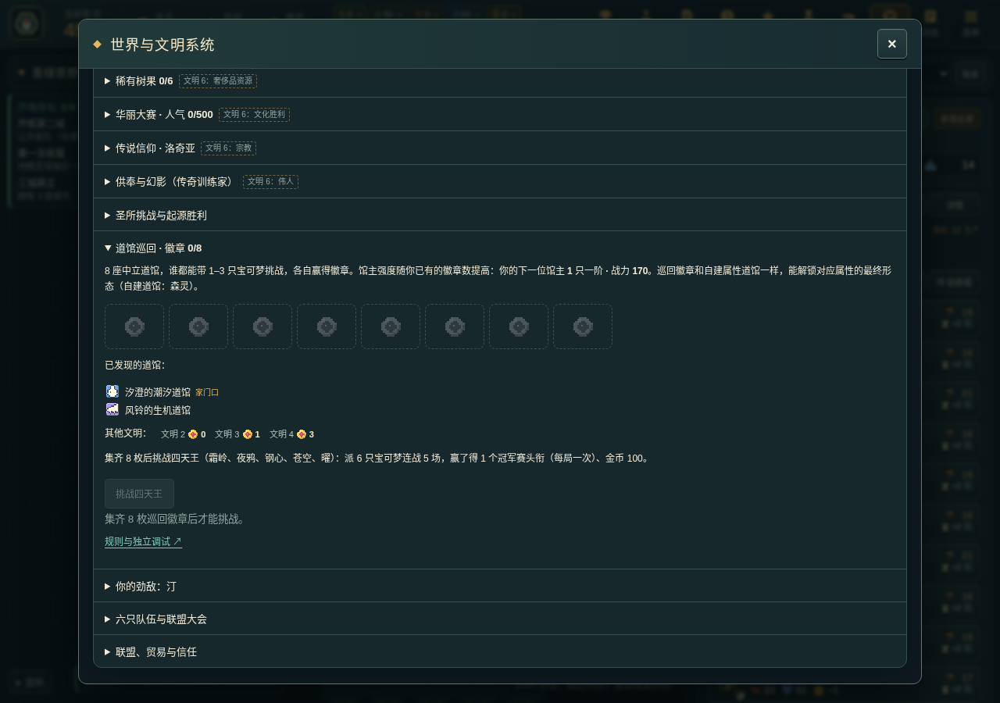 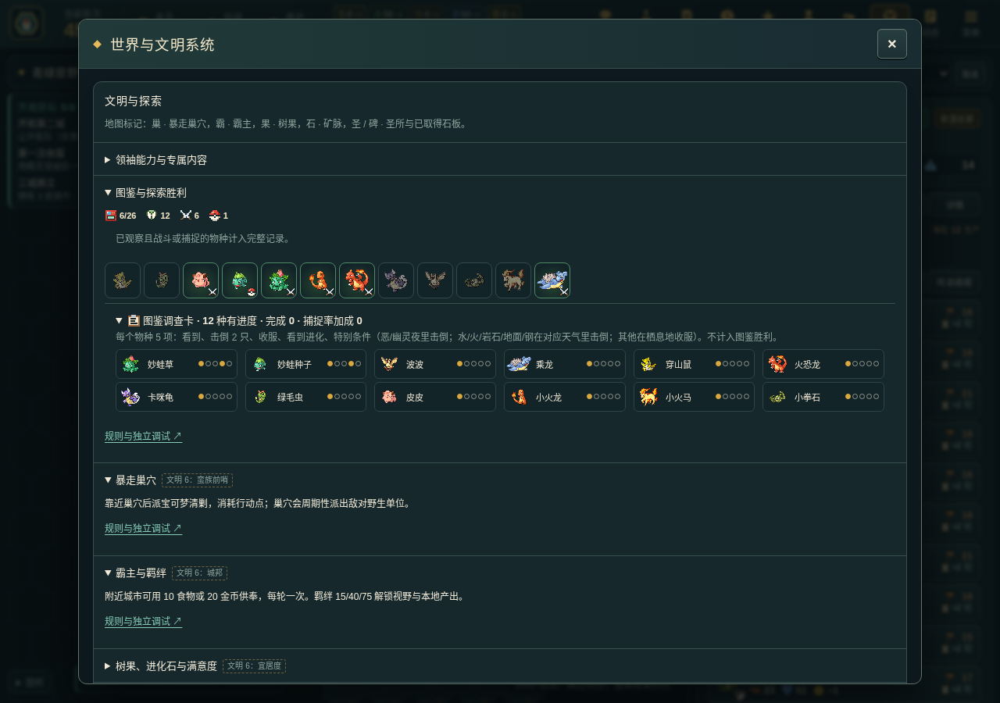 |
| 单位面板 | 名称下的属性徽章与兵种盾徽，HP/EXP 图标，攻击/防御/射程/移动/视野/威力改为“图标 + 数字”格。 | 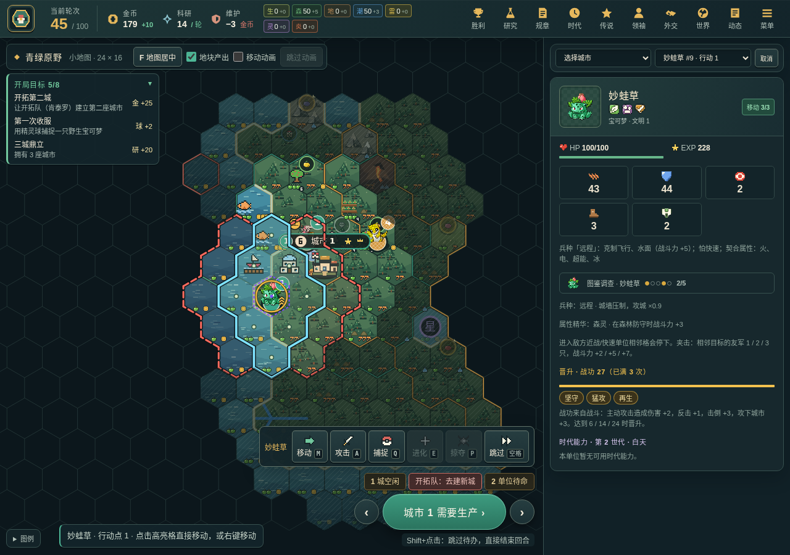 |
| 通知栏 | 每条通知的圆形按钮画像素图标（未知符号保留文字）；按钮的可访问名称不变；布局不变。 | 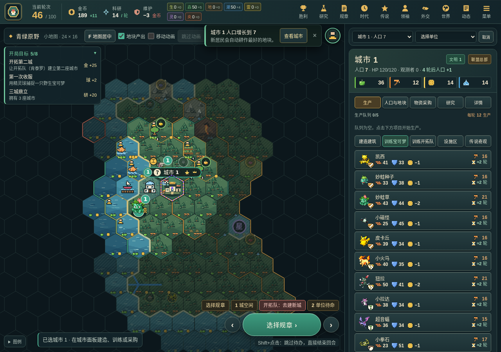 |

## 无障碍与测试

每个只有图标的元素都有可访问名称（`alt` / `aria-label` + `title`），装饰性图标标记 `aria-hidden`。`tests/browser/ui-icons.spec.ts` 用一局真实 v24 对局（AI 操作所有席位，不打补丁）截图每个面板，并检查页面上没有无名图标；`tests/core/ui-icons.test.ts` 检查图标网格与调色板，以及每个解锁图标都以完整句子命名。用 `E2E_SCREENSHOT_DIR=… npx playwright test tests/browser/ui-icons.spec.ts` 重新生成截图（`UI_ICONS_PHASE=before` 写入 `before-*` 截图）。

## 仍保留文字的地方

- 规则解释段落、道馆说明、劲敌台词、四天王说明：这些是叙述性内容，图标替代不了。
- 下拉框（研究课题、城市/单位选择）：原生 `<select>` 不能放图片。
- 单位动作栏、浮动战斗卡、开局目标卡：按要求不改。
- 领袖战术窗口（`<dl>` 效果列表）：单元测试逐字读取这段文字，所以保持原样。

## 宝可梦对战与进化（深度 v26 只做表现：§2.5、§4.1、§4.2、§6.2）

不改规则、AI、视图或权威状态：回放只读事件里现成的 `BattleTrace`（逐击伤害、倍率、剩余 HP），双方阵容按公开规则（馆主 / 四天王 / 守卫队伍）重建，自己的挑战在下命令时记一份队伍快照；每一击的 HP 都和记录核对，对不上就不提供回放。`tools/district-smoke.ts 24` 前后 49/49 逐字节一致。

| 内容 | 位置 | 截图 |
| --- | --- | --- |
| 对战回放器：原创像素对战台（7 种群系 + 联盟会场 + 圣所祭坛）、精灵球出场、冲撞 / 属性色弹道、白闪 + 属性色粒子（对象池、`fillRect`）、HP 条滚动、「效果拔群 / 效果不太好」、倒下下沉变灰、四天王连战换场、胜负横幅；播放 / 暂停、逐步、×1 / ×2 / ×4、跳到结果；逐击记录列表（可访问文本）。减少动态时只画静态画面 + 记录列表。入口：道馆 / 守卫 / 四天王结果通知的「观看对战」，联盟大会卡每场的 ▶。 | `battle-viewer.ts`、`battle-arena.ts`、`battle-replay.ts` | 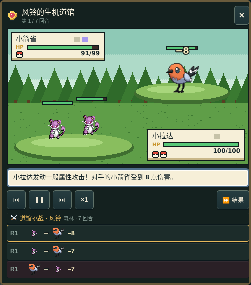 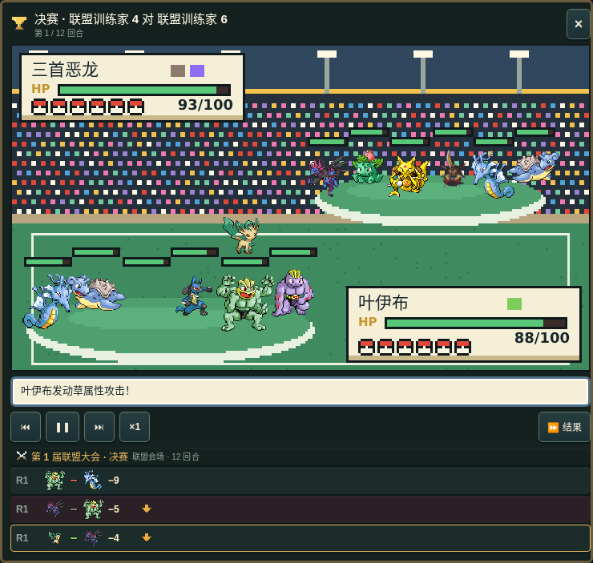 |
| 属性克制格：你的每只 × 对手每只，左上箭头是你打它、右下是它打你（同自动对战的规则：攻击方主属性 × 防守方双属性，含属性研究 ×2.2）。道馆挑战卡；守卫与四天王从世界页先打开同样的预览卡（四天王可切换五场对手）。 | `matchup-grid.ts`、`challenge-card.ts`、`gym-panel.ts` | 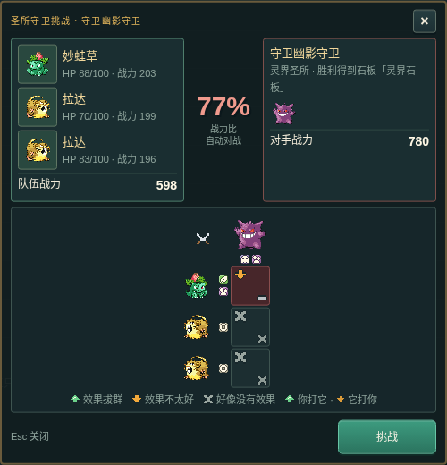 |
| 联盟大会对阵表：两场预赛 → 两场半决赛 → 决赛 → 冠军，每格是文明旗 / 原创训练家图标 + 首发精灵图 + 赛后 HP，冠军路线金色、你的路线绿色。独立模块，世界页可直接复用。 | `league-bracket.ts`（接入 `league-card.ts`） | 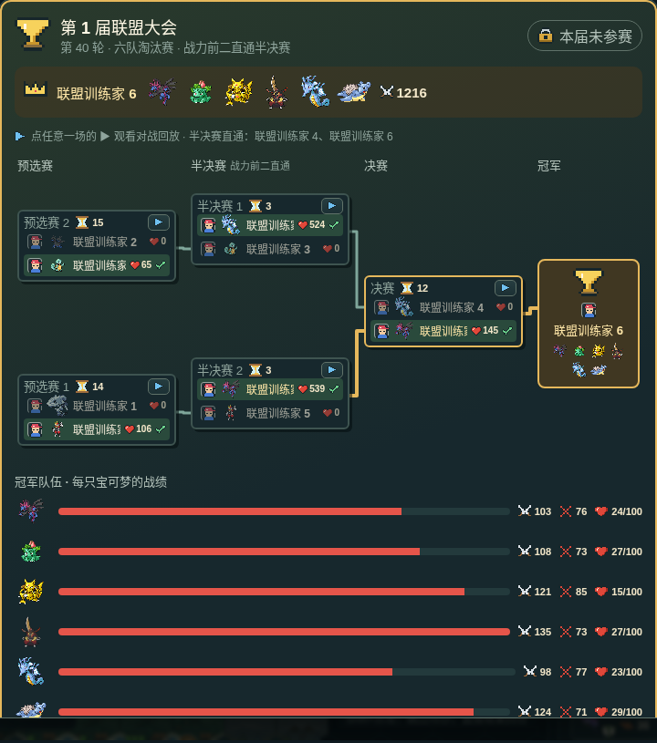 |
| 进化条件面板：整条进化线（未登记的画剪影），每个下一形态一张卡（伊布 5 个分支、进化石路线也在），条件是图标：经验条、神奇糖果、金币、特训法、世代锁、昼 / 夜、地形、进化石库存，满足 ✓ / 未满足 ✗；最终形态另列“城市直接训练要徽章”。条件全部调用权威的规则函数。 | `evolution-panel.ts` | 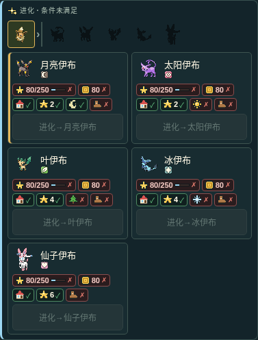 |
| 进化演出：变暗光芒背景，旧 / 新形态的白色剪影交替、越来越快（`EVOLUTION_SWAPS`），白色新形态后彩色显现 + 星形闪光 + 「进化！」+ 原创号角（`evolveFanfare`）。其他玩家可见单位的进化在事件队列之后播放，屏幕外不占时间（V7）；减少动态时直接换形态加一圈短暂光晕。 | `render/animation.ts` `evolutionTrack`、`render/canvas2d.ts` | 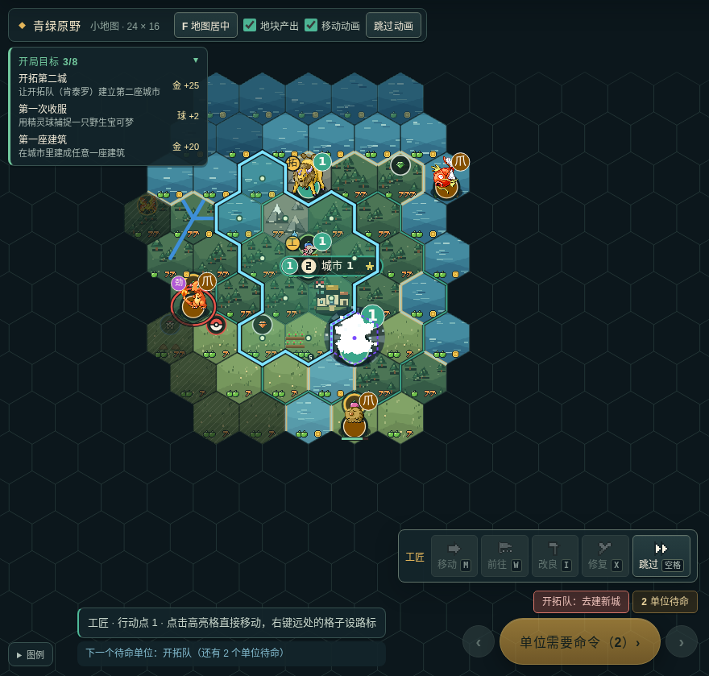 |

新增原创图标：`candy`、`sun`、`moon`、`matchupUp` / `matchupDown` / `matchupNone` / `matchupEven`、`trainer`、地形 `grassTuft` / `tree` / `peak` / `dune` / `snowflake` / `volcanoCone`。测试：`tests/core/battle-replay.test.ts`（回放与权威结果逐击一致）、`tests/browser/battle-evo.spec.ts`（真实 AI 存档、真实输入、音效 spy）。
