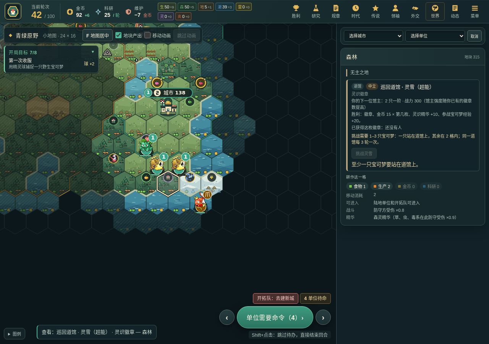
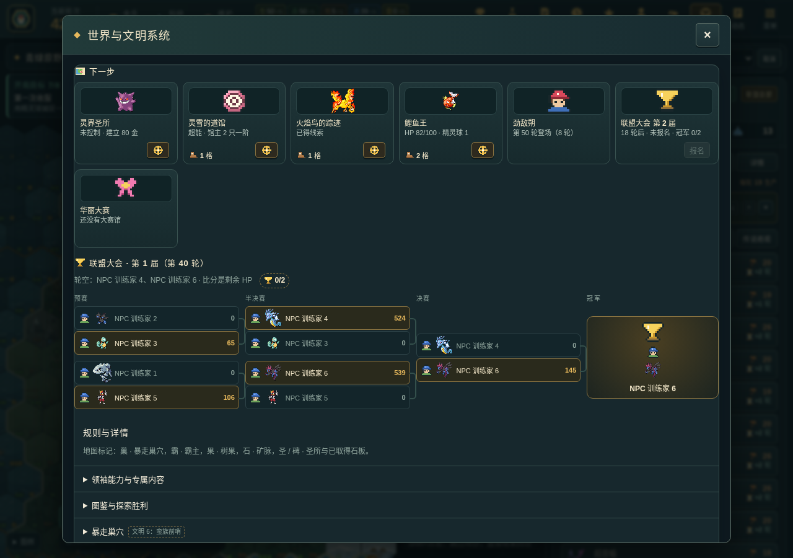
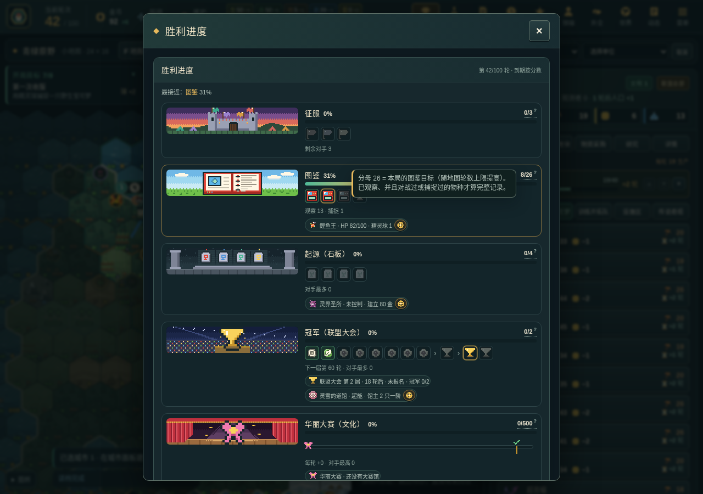
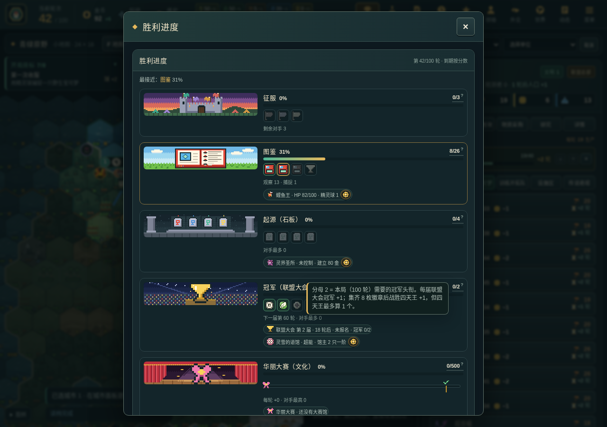
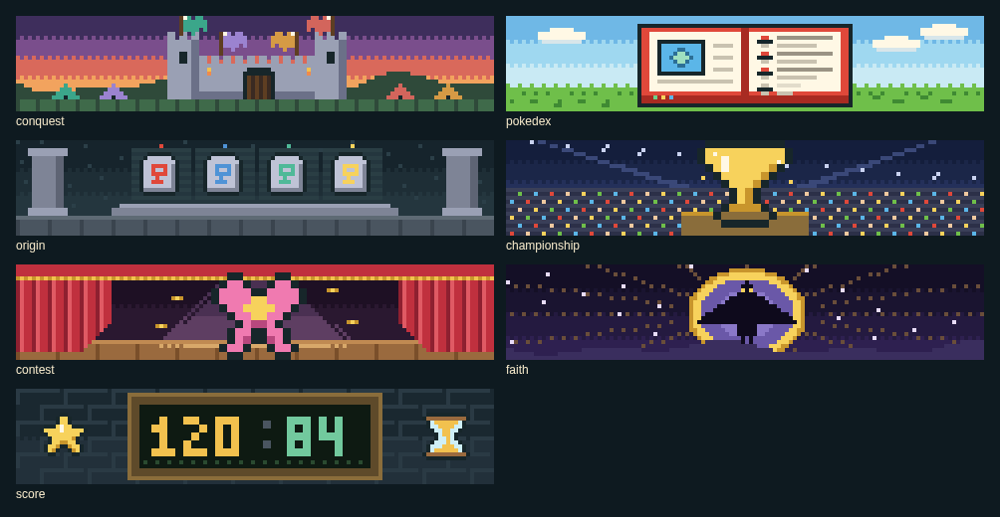
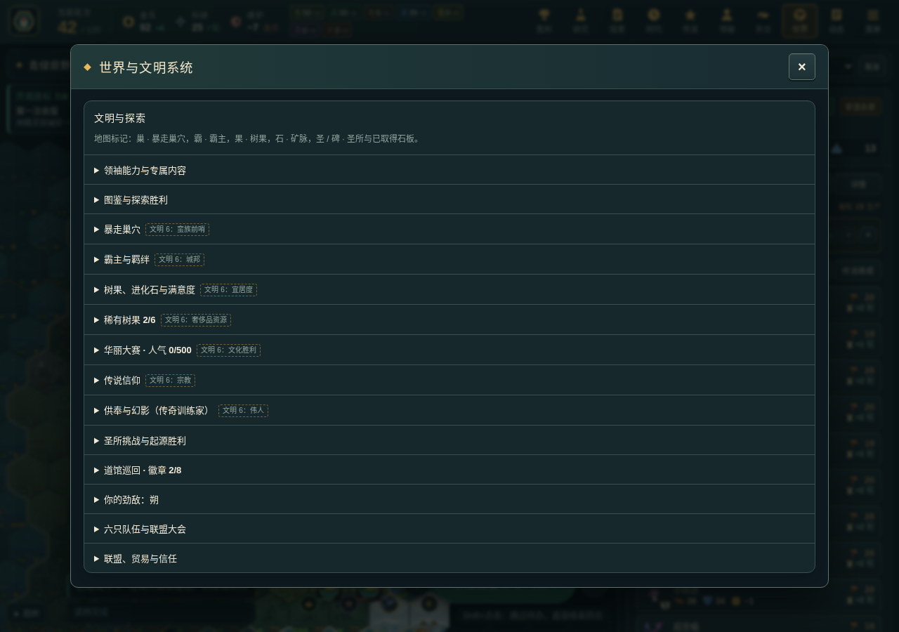
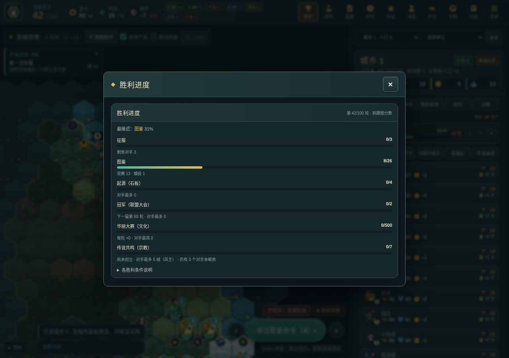

# 图标优先的界面（UI icon kit）

用户反馈：“UI 尽量避免纯文字，多一点 icon、图片，比如研究树这些”。本轮只改呈现层（面板渲染、CSS、新图标模块），不改规则、AI 或权威状态，也不新增玩法版本。

## 图标套件

`src/browser/ui-icons.ts` 提供共享图标：每个图标都是调色板网格（和 `src/browser/map-icons.ts` 的地图图标同一种 GBA 式硬边像素画法），首次使用时渲染成缓存的 SVG data URL，`image-rendering: pixelated` 保持锐利。新画的图标全部为本项目原创；徽章边框由代码生成（亮左上、暗右下、深色描边），图案是手工放置的填充格，自动加 1 格描边。不使用任何官方道具美术；宝可梦精灵图沿用 `public/sprites`，建筑沿用 `public/buildings/*.svg`。

| 组 | 名称 | 说明 |
| --- | --- | --- |
| 属性徽章 `type:*` | 18 种属性 | 方形徽章，底色取自 `src/content/type-colors.ts` |
| 道馆徽章 `gym:*` | 18 种属性 | 八角形奖章，用于徽章盒 |
| 兵种 `class:*` | 近战、远程、快速、侦察、攻城、飞行、水面 | 盾形徽章 |
| 秘传 `hm:*` | 冲浪、怪力、骑乘、飞翔 | 圆形徽章 |
| 资源与计量 | `civics` 规章点、`faith` 信仰/供奉、`eraScore` 世代分、`satisfaction` 满意度、`badge` 徽章、`essence` / `essence:*` 精华（7 色）、`turns` 轮数、`heart` HP、`medicine` 恢复 | |
| 道具 | `pokeBall`、`greatBall`、`masterBall`；树果与进化石沿用地图图标（`oranBerry`、`fireStone` 等） | 原创红白配色像素画 |
| 解锁类别 | `building`、`unit`、`district`、`improvement`、`policyCard`、`wonder`、`effect` | |
| 单位属性 | `attack`、`defense`、`move`、`range`（视野用 `class:scout`） | |
| 状态与其他 | `check`、`play`、`lock`、`pokedex`、`nest`、`clipboard`、`swords`、`handshake`、`trophy`、`ribbon`、`egg`、`map`、`brick`、`anvil`、`cloud` | 科技主题图标等 |
| 地图图标复用 | 产出、资源、改良、设施区、标记 | 来自 `map-icons.ts`，经 `mapIconGrid()` 共享 |

辅助函数：`uiIcon(name, { size, label })`（有 `label` 时带 `alt` + `title`，否则 `aria-hidden`）、`artImage(src, …)`（精灵图 / 建筑 SVG）、`statChip(icon, value, label)`（图标 + 数字，`role="img"` + `aria-label`）、`typeBadge(type)`。`src/browser/ui-tip.ts` 是一张共享的悬停卡（鼠标悬停和键盘聚焦都会打开），样式与「文明 6」提示卡一致。

## 已改的面板

| 面板 | 改动 | 截图 |
| --- | --- | --- |
| 科技树 | 每个节点：主题图标、角标状态（完成 / 研究中 / 锁定）、科研与轮数图标、图鉴发现标记、解锁图标条（招募物种精灵图、建筑 SVG、设施区/改良图标、秘传徽章、效果图标）。完整文字移到悬停卡和右侧详情；前置连线、键盘与滚动不变。旧版三层研究页也换成图标解锁行。 |  |
| 规章树与体制 | 规章徽记 + 状态角标、规章点/轮数图标、槽位小卡、方针卡图标（名称与效果是可访问名称）；体制卡显示徽记、层级、领袖偏好星标和效果图标。 |  |
| 城市生产 | 精灵图/建筑图带兵种盾徽；建筑产出、攻防、维护改为图标数字；生产与轮数图标；产出格与设施区用图标。 |   |
| 时代与献礼 | 世代分图标、每种得分里程碑图标、黑暗/黄金线图标、时代能力图标与解锁角标、献礼「承诺/黄金」图标。 |  |
| 世界页 | 图鉴计数图标 + 已观察物种精灵图条；图鉴调查卡与调查本（精灵图 + 每项任务图标）；巢穴/霸主行（图标或精灵图、HP 或羁绊条）；树果、进化石、满意度图标；道馆巡回 8 枚奖章槽、道馆属性徽章、其他文明徽章数。 |   |
| 单位面板 | 名称下的属性徽章与兵种盾徽，HP/EXP 图标，攻击/防御/射程/移动/视野/威力改为“图标 + 数字”格。 |  |
| 通知栏 | 每条通知的圆形按钮画像素图标（未知符号保留文字）；按钮的可访问名称不变；布局不变。 |  |

## 无障碍与测试

每个只有图标的元素都有可访问名称（`alt` / `aria-label` + `title`），装饰性图标标记 `aria-hidden`。`tests/browser/ui-icons.spec.ts` 用一局真实 v24 对局（AI 操作所有席位，不打补丁）截图每个面板，并检查页面上没有无名图标；`tests/core/ui-icons.test.ts` 检查图标网格与调色板，以及每个解锁图标都以完整句子命名。用 `E2E_SCREENSHOT_DIR=… npx playwright test tests/browser/ui-icons.spec.ts` 重新生成截图（`UI_ICONS_PHASE=before` 写入 `before-*` 截图）。

## 仍保留文字的地方

- 规则解释段落、道馆说明、劲敌台词、四天王说明：这些是叙述性内容，图标替代不了。
- 下拉框（研究课题、城市/单位选择）：原生 `<select>` 不能放图片。
- 单位动作栏、浮动战斗卡、开局目标卡：按要求不改。
- 领袖战术窗口（`<dl>` 效果列表）：单元测试逐字读取这段文字，所以保持原样。

## 世界页“下一步”、联盟大会对阵表、胜利路线（depth-v26 §6，只做表现）

试玩 U4：世界页原来是 13 个折叠的规则区块，胜利页只有进度条。本轮只改呈现层，不改规则、命令、视图或 AI（`tools/district-smoke.ts 24` 前后逐字节相同）。

- **下一步卡片**（`src/browser/world-cards.ts`）：世界页首屏，按紧迫度排序（倒计时 ≤ 2 轮的在前）。卡片覆盖下一座道馆（或四天王）、劲敌、联盟大会、华丽大赛、最近的巢穴、圣所、传说踪迹、可捕捉的野生、快要进化。每张卡是贴图或图标、一行状态、距最近己方单位或城市的格数和一个**定位**按钮（新图标 `locate`，准星）；完整说明在悬停卡里（`data-tip`，鼠标悬停和键盘聚焦都能打开）。定位会关闭页面，把相机移到目标格（环绕地图取离当前视野最近的那份副本），选中该格，并在该格播 1.5 秒的金色 `chevron` 脉冲。卡片只读 `PlayerView`：道馆只来自已探索格，巢穴、圣所、野生只来自当前视野，传说踪迹只来自看过的格，所以不会泄露迷雾里的东西。原有区块保留在下面，标题“规则与详情”。
- **联盟大会对阵表**：读最近一届 `ChampionshipSeason`：预赛 → 半决赛 → 决赛 → 冠军，每格是文明旗帜（`flag` 图标按文明颜色上色）或原创 NPC 训练家小头像（`trainer`）、首发宝可梦贴图和剩余 HP 比分，胜者高亮。旁边的奖杯计数用悬停卡说明分母（“本局要 N 个头衔；四天王最多算 1 个”，修正 B4 的“两届冠军即胜利”文字）。不碰通知栏和结果提示。
- **胜利路线**（`src/browser/victory-panel.ts`、`src/browser/victory-banners.ts`）：每条路线一张原创 120×24 像素横幅（2 倍显示为 240×48）：征服是城堡与四个文明的旗帜，图鉴是草地上打开的图鉴，起源是四块石板，冠军是聚光灯下的奖杯与看台，华丽大赛是舞台、幕布与缎带，传说共鸣是光环里的抽象剪影，分数是计分板。横幅旁是路线图：里程碑图标按已完成 / 下一步 / 未完成着色（冠军路线 = 8 格徽章 → 四天王 → 本局需要的头衔；起源 = 四块石板；征服与宗教 = 各对手旗帜；华丽大赛 = 人气条 + 对手最高 + 1.5 倍线 + 最低线）。`x/y` 计数的悬停卡解释分母从哪里来。每条路线下有 1–2 个“下一步”芯片，复用卡片数据并带定位按钮。
- 新图标：`locate`、`rival`、`trainer`、`tablet`、`flag`（都在 `ui-icons.ts` 的调色板网格里，原创）。

| 世界页 | 对阵表 | 胜利页 | 横幅 |
| --- | --- | --- | --- |
|   |  |   |  |

改前： 。截图由 `tests/browser/world-ui.spec.ts` 生成（`WORLD_UI_PHASE=before` 写入 `before-*`），一局真实 v24 对局（AI 操作所有席位，不打补丁）。
